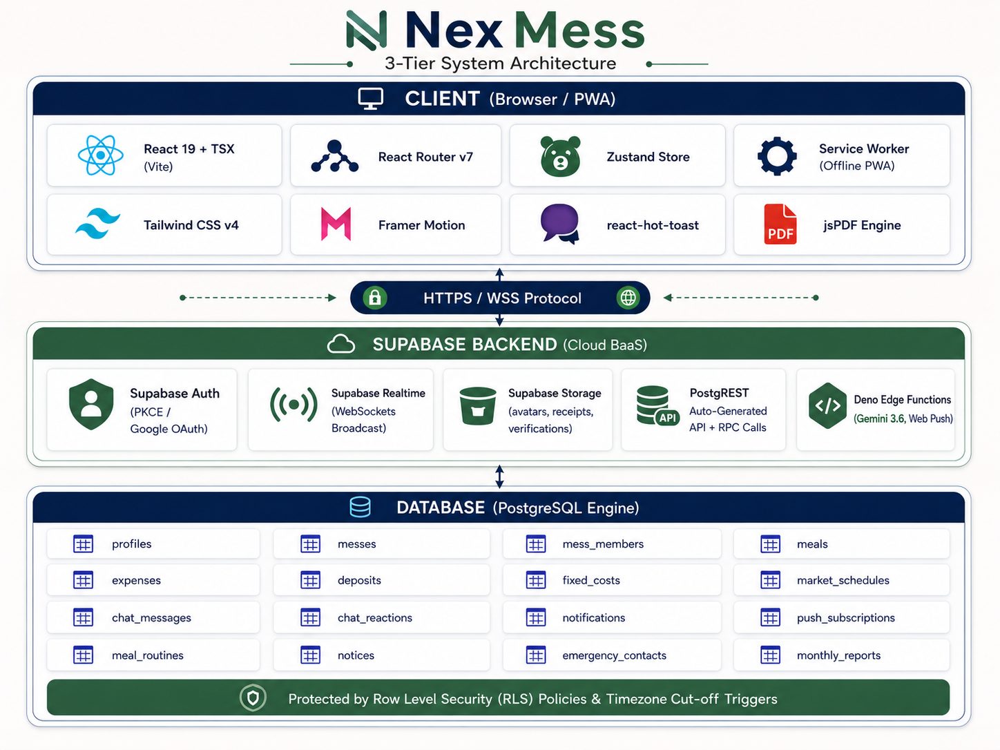

# ⚡ NexMess — Smart Mess Management & Shared Living Ecosystem

> **NexMess** (also branded as **Nex Mess**) is a modern, enterprise-ready smart mess management platform built with React 19, TypeScript, Tailwind CSS v4, Zustand 5, and Supabase PostgreSQL. Deployed live at **[https://nexmess.shop/](https://nexmess.shop/)**.

---

### 📖 [Read the NexMess Project Showcase Report (PDF)](./NexMess_Report/NexMess_Report.pdf)

[](https://nexmess.shop/)
[](./NexMess_Report/NexMess_Report.pdf)
[](https://react.dev/)
[](https://www.typescriptlang.org/)
[](https://supabase.com/)
[](https://ai.google.dev/)

---

## 📸 Website Landing Page Preview


---

## 🏛️ System Architecture Diagram

NexMess operates as a modern 3-tier cloud application comprising a Client SPA / PWA layer, a Supabase Cloud BaaS layer, and a managed PostgreSQL Database layer.



---

## ✨ Core Features & Technical Highlights

- 🍽️ **Daily Meal Tracker & Cut-Off Engine** — Log daily meals (breakfast, lunch, dinner) and guest meals. Features timezone-aware automatic cut-off locks (10:00 AM / 4:00 PM) to prevent food waste and Manager Override RPCs for past dates.
- 💰 **Finance & Expense Splitter** — Track daily grocery expenses, member deposits, and recurring fixed costs (rent, Wi-Fi, maid salary). Features dynamic meal rate calculations (`Meal Rate = Total Grocery / Total Meals`), net member balances, greedy debt settle-up recommendations, and instant vector PDF report exports using `jsPDF`.
- 🤖 **NexMess AI Market Assistant** — Integrated with **Google Gemini 3.6 Flash AI** with search grounding to provide daily local market price estimations, budget calculations for mess members, and automated grocery shopping list generation.
- 🛒 **Marketplace & Rotating Bazaar Roster** — Shared household shopping list combined with an automated round-robin bazaar duty rotation calendar.
- 🍲 **Meal Routines & Weekly Preferences** — Day-by-day weekly menu planner mapped to dish categories and ingredient presets with food emojis.
- 💬 **Real-Time Roommate Chat & Notice Board** — Instant group messaging room with photo receipt attachments, pinned announcement headers, and emoji reactions powered by Supabase Realtime WebSockets.
- 🔑 **Multi-Tenant Workspaces & RBAC** — Create or join private mess apartments via 8-character codes (`NEX-XXXX`) with strict Manager vs Member role-based access control.
- 📲 **Installable PWA & Web Push Notifications** — Progressive Web App with offline schedule caching and automated background Web Push alerts.
- 🛡️ **Row Level Security (RLS) & Audit Log** — Full PostgreSQL database isolation ensuring member data privacy alongside an immutable activity audit log timeline.

---

## 🛠️ Technology Stack Matrix

| Architecture Layer | Technology / Framework | Key Benefit & Role |
| :--- | :--- | :--- |
| **Frontend UI** | **React 19 & TypeScript** | Instant responsive UI updates and type-safe code execution |
| **Styling & Theme** | **Tailwind CSS v4 & Lucide Icons** | Custom Sage Green design tokens and dark/light theme switching |
| **State Management** | **Zustand 5 (Persisted)** | Fast reactive state management across mess workspaces |
| **Backend BaaS** | **Supabase Cloud PostgreSQL** | Row Level Security (RLS), Realtime Channels & Storage buckets |
| **AI Infrastructure** | **Google Gemini 3.6 Flash AI** | Real-time local market price reports and grocery list estimation |
| **PDF Audits** | **jsPDF & AutoTable** | Client-side vector PDF statement compilation and downloads |
| **Offline & PWA** | **Vite PWA Plugin & Service Worker** | Mobile-native app installation and offline schedule viewing |

---

## 📁 Repository & Project Structure

```
NexMess/
├── NexMess_Report/          # Complete Showcase Report & Media Assets
│   ├── NexMess_Report.pdf   # Downloadable / Viewable Project Showcase PDF Report
│   ├── NexMess_Report.html  # Interactive Web Showcase Report
│   ├── 01_landing.png ... 14_404_page.png
│   └── system_architecture.png
├── src/
│   ├── components/          # Reusable UI components & layouts
│   ├── guards/              # Route protection guards (AuthGuard, ManagerGuard)
│   ├── lib/                 # Supabase client configuration & helpers
│   ├── pages/               # Application pages (auth, dashboard, meals, finance, market, nexmess-ai, chat, settings)
│   ├── stores/              # Zustand state stores (authStore, messStore, mealStore, financeStore)
│   └── types/               # TypeScript interfaces & database schemas
└── supabase/                # Database migrations, RPC functions & RLS policies
```

---

## 🚀 Getting Started Locally

### Prerequisites
- Node.js 18+
- A [Supabase Cloud Project](https://supabase.com)

### Installation Steps

```bash
# 1. Clone the repository
git clone https://github.com/KMSiam/NexMess.git
cd NexMess

# 2. Install dependencies
npm install

# 3. Configure Environment Variables
cp .env.example .env
```

Set your Supabase credentials in `.env`:
```env
VITE_SUPABASE_URL=https://your-supabase-project-id.supabase.co
VITE_SUPABASE_ANON_KEY=your-supabase-anon-key
```

```bash
# 4. Start the local development server
npm run dev
```

---

## 📖 Complete Project Showcase Report

For a complete breakdown of every page, visual component, 3-tier architecture diagram, test scenarios, and Manager vs Member role privileges, download or view the **[NexMess Showcase Report PDF](./NexMess_Report/NexMess_Report.pdf)** or open the **[Interactive HTML Report](./NexMess_Report/NexMess_Report.html)**.
