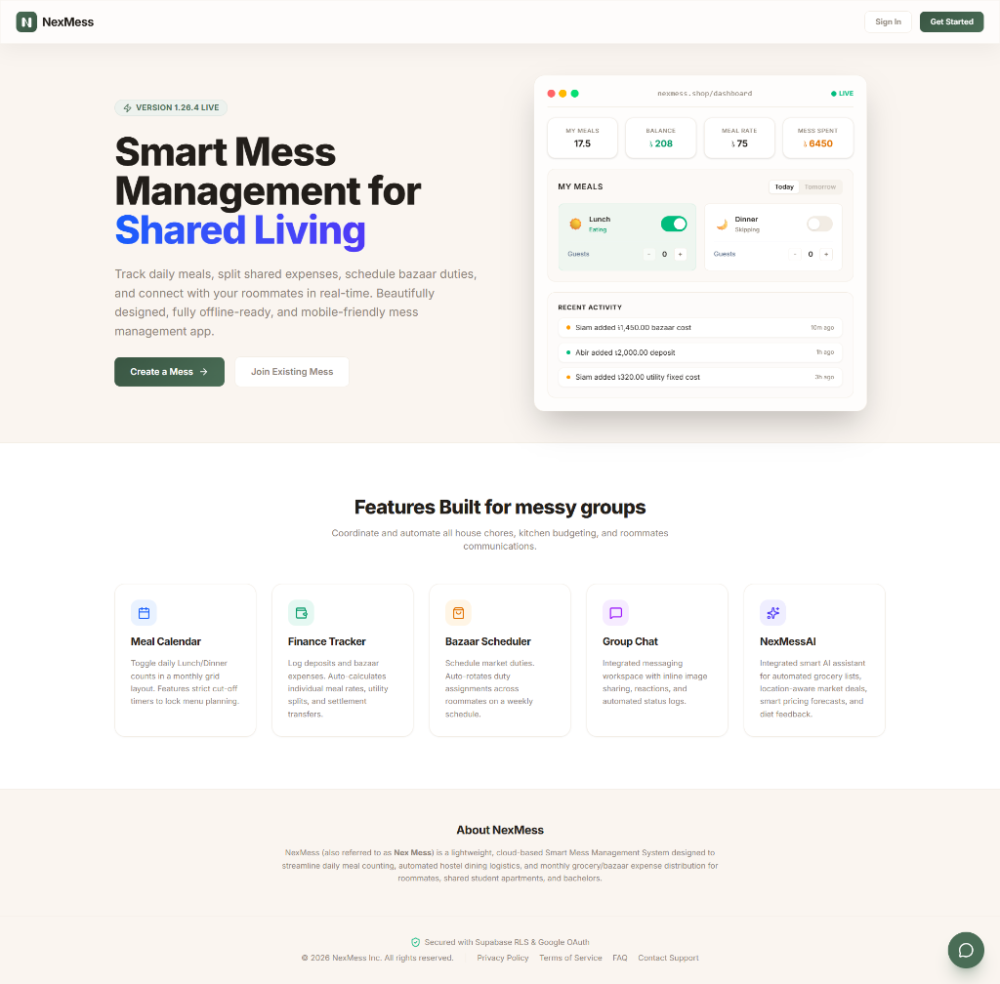

# ⚡ NexMess — Smart Mess Management & Shared Living Ecosystem

> **NexMess** (also branded as **Nex Mess**) is a modern, enterprise-ready smart mess management platform built with React 19, TypeScript, Tailwind CSS v4, Zustand 5, and Supabase PostgreSQL. Deployed live at **[https://nexmess.shop/](https://nexmess.shop/)**.

---

### 📖 [Read the NexMess Project Showcase Report (PDF)](./docs/NexMess_Report/NexMess_Report.pdf) | [Interactive HTML Guide](./docs/NexMess_Report/NexMess_Report.html)

[](https://nexmess.shop/)
[](./docs/NexMess_Report/NexMess_Report.pdf)
[](https://react.dev/)
[](https://www.typescriptlang.org/)
[](https://supabase.com/)
[](https://ai.google.dev/)
[](https://tailwindcss.com/)
[](https://vitest.dev/)
[](https://github.com/KMSiam/NexMess/actions/workflows/ci.yml)

---

## 📸 Website Landing Page Preview



---

## 🏛️ 3-Tier System Architecture

NexMess is designed as a cloud-native 3-tier application:

1. **Client Presentation Tier (SPA & PWA)**: React 19, TypeScript, Tailwind CSS v4, Zustand 5 client stores, and Service Worker offline caching.
2. **Backend-as-a-Service Tier (Supabase BaaS & Edge Functions)**: Supabase Authentication (OAuth & PKCE), Realtime WebSocket channels, Storage buckets, and Deno Edge Functions (Google Gemini 3.6 Flash AI, Web Push, and Resend email).
3. **Database Tier (Managed PostgreSQL)**: Row Level Security (RLS) policies per mess workspace, automated SQL cut-off triggers, and ACID-compliant transactional accounting ledgers.


---

## ✨ Core Features & Technical Highlights

- 🍽️ **Daily Meal Tracker & Cut-Off Engine** — Log daily meals (breakfast, lunch, dinner) and guest meals. Features timezone-aware automatic cut-off locks (10:00 AM for lunch / 4:00 PM for dinner in Asia/Dhaka UTC+6) to prevent food waste and Manager Override RPCs for historical updates.
- 💰 **Dynamic Meal Rate & 5-Tab Finance Suite**:
  - **Expenses Tab**: Itemized daily grocery costs with receipt photo uploads.
  - **Deposits Tab**: Member payments with Manager verification workflows.
  - **Fixed Costs Tab**: Shared utility expenses (apartment rent, Wi-Fi, cook salary) split evenly.
  - **Summary Tab**: Live member balances with greedy debt settlement recommendations.
  - **History Tab**: Automated monthly ledger archives with one-click **vector PDF downloads** powered by `jsPDF` & `jspdf-autotable`.
- 🤖 **NexMess AI Market Assistant** — Integrated with **Google Gemini 3.6 Flash AI** with web search grounding to provide daily local market price estimations, budget calculations for roommates, and automated grocery shopping lists.
- 🛒 **Marketplace & Rotating Bazaar Roster** — Shared household shopping list combined with an automated 7-day round-robin bazaar duty rotation calendar.
- 🍲 **Meal Routines & Weekly Preferences** — Day-by-day weekly menu planner mapped to dish categories and ingredient presets with food emojis.
- 💬 **Real-Time Roommate Chat & Notice Board** — Instant group messaging room with photo receipt attachments, pinned announcement headers, and emoji reactions powered by Supabase Realtime WebSockets.
- 🔑 **Multi-Tenant Workspaces & RBAC** — Create or join private mess apartments via 8-character codes (`NEX-XXXX`) with strict Manager vs Member role-based access control.
- 📲 **Installable PWA & Web Push Notifications** — Progressive Web App with offline schedule caching and automated background Web Push alerts.
- 🛡️ **Row Level Security (RLS) & Audit Log** — Full PostgreSQL database isolation ensuring member data privacy alongside an immutable activity audit log timeline.
- 📊 **Production Observability & Telemetry (Phase 1)** — Real-time crash monitoring and error boundaries powered by **Sentry**, combined with privacy-friendly product analytics and conversion funnels powered by **PostHog**.

---

## 🛠️ Technology Stack Matrix

| Architecture Layer | Technology / Framework | Role & Key Benefit |
| :--- | :--- | :--- |
| **Frontend UI** | **React 19 & TypeScript 5.7** | Fast responsive UI updates, robust type safety, zero compile bugs |
| **Styling & Icons** | **Tailwind CSS v4 & Lucide Icons** | Modern Sage Green theme, glassmorphic layout, crisp vector iconography |
| **State Management** | **Zustand 5 (Persisted)** | Lightweight reactive state management with localStorage persistence |
| **Backend & Database**| **Supabase Cloud PostgreSQL** | Multi-tenant Row Level Security (RLS), Realtime Channels, and Storage |
| **AI Infrastructure** | **Google Gemini 3.6 Flash AI** | Real-time local grocery price reports with Google Search grounding |
| **Document Engine** | **jsPDF & AutoTable** | Client-side vector PDF statement compilation and instant downloads |
| **PWA & Offline** | **Vite PWA Plugin & Workbox** | Installable home-screen web app with offline timetable caching |
| **Routing & Motion** | **React Router DOM 7 & Framer Motion** | Smooth page transitions, animated modals, and nested sub-routes |
| **Observability** | **Sentry 11 & PostHog** | Automated client crash reporting, error boundaries, and funnel analytics |

---

## 👑 Role-Based Access Control (RBAC)

NexMess enforces strict permission boundaries between **Mess Managers** and **Mess Members**:

| Feature / Module | Mess Member | Mess Manager (Admin) |
| :--- | :---: | :---: |
| **View Dashboard & Balance** | ✅ Read-only | ✅ Full Access |
| **Log Personal & Guest Meals** | ✅ (Before Cut-off) | ✅ (Before Cut-off) |
| **Manager Meal Override (Past Dates / Others)** | ❌ Blocked | ✅ Full Edit Authority |
| **View Shared Finance & Summaries** | ✅ Read-only | ✅ Full Access |
| **Log Grocery Expense & Receipt** | ✅ Allowed | ✅ Edit / Delete Any |
| **Submit Deposit Payment** | ✅ Submit for Approval | ✅ Verify & Approve |
| **Manage Fixed Utility Bills (Rent/Wi-Fi)**| ❌ Blocked | ✅ Add / Edit / Mark Paid |
| **Export Monthly PDF Report** | ✅ Download | ✅ Generate & Archive |
| **Bazaar Roster Duty** | ✅ View Schedule | ✅ Auto-Assign & Swap Dates |
| **Notice Board Announcements** | ❌ Read-only | ✅ Publish & Pin Notices |
| **Approve / Reject New Join Requests** | ❌ Blocked | ✅ Full Authority |
| **Mess Settings & Delete Workspace** | ❌ Blocked | ✅ Full Authority (Danger Zone) |

---

## 📁 Repository & Project Structure

```
NexMess/
├── .env.example             # Environment variable template for new setups
├── .github/workflows/       # GitHub Actions CI pipeline (lint, type-check, test, build)
├── docs/                    # Project documentation, management & showcase reports
│   ├── NexMess_Report/      # Complete Showcase Report & Media Assets
│   │   ├── NexMess_Report.pdf   # Complete Project Showcase PDF Report
│   │   ├── NexMess_Report.html  # Standalone Interactive Web Showcase Report
│   │   ├── 01_landing.png ... 14_terms_of_service.png
│   │   └── system_architecture.png
│   ├── NexMess_Project_Report_seu.pdf # Full Project Report PDF
│   ├── PROGRESS.md          # Development progress log & pending rollout checklist
│   ├── ROADMAP.md           # Commercialization & production scale roadmap
│   └── SECURITY.md          # Security policy & vulnerability reporting
├── e2e/                     # Playwright end-to-end smoke tests
├── public/                  # Static assets, PWA icons, favicon, robots.txt, sitemap.xml
├── scripts/                 # Utility scripts (e.g. generate-vapid-keys.mjs)
├── sql/                     # PostgreSQL database schemas, triggers & RLS policies
│   ├── market_ai_assistant.sql      # AI chat table & triggers
│   ├── meal_cutoff_trigger.sql      # Automated cut-off enforcement
│   ├── monthly_reports.sql          # Monthly report calculation functions
│   ├── push_subscriptions.sql       # Web Push subscriptions table
│   ├── rls_audit.sql                # RLS security verification audit
│   └── secure_polish_migrations.sql # Storage buckets & verification policies
├── src/
│   ├── assets/              # Brand logo & icon SVGs
│   ├── components/          # Reusable UI components (AppLayout, Modals, NotificationBell, etc.)
│   ├── guards/              # Route protection guards (AuthGuard)
│   ├── hooks/               # Custom React hooks (useDashboardData, useFinanceData, useSEO, etc.)
│   ├── lib/                 # Supabase client, PDF generator, push, validation & unit tests
│   ├── locales/             # i18n translation dictionaries (en.json, bn.json)
│   ├── pages/               # Application pages (auth, dashboard, meals, finance, market, chat, settings, etc.)
│   ├── stores/              # Zustand stores (authStore, messStore, themeStore)
│   └── types/               # TypeScript interfaces & database definitions
├── supabase/
│   └── functions/           # Supabase Deno Edge Functions
│       ├── market-assistant/        # Gemini 3.6 Flash AI assistant endpoint
│       ├── send-push/               # Web Push dispatcher
│       ├── send-feedback-email/     # User feedback email delivery via Resend
│       └── morning-reminder/        # Automated morning meal reminder cron
├── index.html               # Main HTML entry point
├── package.json             # NPM dependencies and project scripts
├── README.md                # Main repository guide & setup instructions
├── vercel.json              # Vercel SPA rewrites and cache headers
└── vite.config.ts           # Vite build configuration with PWA plugin
```

---

## 🚀 Complete Step-by-Step Installation & Setup Guide

Follow this comprehensive guide to set up and run NexMess on your local machine or deploy it to production.

### Prerequisites

Make sure you have the following installed on your machine:
- **Node.js**: `v18.0.0` or higher ([Download Node.js](https://nodejs.org/))
- **Package Manager**: `npm` (comes with Node.js), `yarn`, or `pnpm`
- **Git**: Installed and configured ([Download Git](https://git-scm.com/))
- **Supabase Account**: A free account at [Supabase.com](https://supabase.com/)

---

### Step 1: Clone the Repository

Clone the project to your local machine and navigate into the project folder:

```bash
git clone https://github.com/KMSiam/NexMess.git
cd NexMess
```

---

### Step 2: Install Dependencies

Install all required frontend dependencies:

```bash
npm install
```

---

### Step 3: Configure Environment Variables

1. Copy the environment configuration template:
   ```bash
   cp .env.example .env
   ```
2. Open `.env` in your text editor. You will see:
   ```env
   # Supabase Configuration (Required)
   VITE_SUPABASE_URL=https://your-project-id.supabase.co
   VITE_SUPABASE_ANON_KEY=your-supabase-anon-key

   # Web Push Configuration (Optional)
   VITE_VAPID_PUBLIC_KEY=your-vapid-public-key

   # Observability & Telemetry (Optional - Phase 1)
   VITE_SENTRY_DSN=your-sentry-dsn
   VITE_POSTHOG_KEY=your-posthog-key
   VITE_POSTHOG_HOST=https://us.i.posthog.com
   ```
3. Replace the placeholder values with your actual project credentials (explained in Step 4 below).

---

### Step 4: Supabase Cloud Database & Authentication Setup

#### 1. Create a Supabase Project
1. Go to [https://supabase.com/dashboard](https://supabase.com/dashboard) and sign in.
2. Click **New Project**, choose an organization, name your project (e.g. `nexmess-dev`), set a secure database password, and select your preferred region.

#### 2. Get Your API Credentials
1. In your Supabase Dashboard, go to **Project Settings** (gear icon) -> **API** (or **Data API**).
2. Copy the **Project URL** and paste it as `VITE_SUPABASE_URL` in your `.env`.
3. Copy the **anon / public** API key and paste it as `VITE_SUPABASE_ANON_KEY` in your `.env`.

#### 3. Run Database Migrations (SQL Scripts)
NexMess uses PostgreSQL with Row Level Security (RLS). Run the provided SQL scripts in your Supabase **SQL Editor**:
1. Open the **SQL Editor** tab in Supabase.
2. Execute the migration scripts located in the `sql/` directory:
   - `sql/secure_polish_migrations.sql`: Sets up secure storage buckets (`verifications`, `receipts`) and base RLS policies.
   - `sql/avatars_chat_storage.sql`: Sets up public storage buckets for profile avatars and chat attachments.
   - `sql/meal_cutoff_trigger.sql`: Creates automated database triggers enforcing 10:00 AM / 4:00 PM meal cut-off locks.
   - `sql/market_ai_assistant.sql`: Sets up the table for the AI Market Assistant messages.
   - `sql/push_subscriptions.sql`: Creates the push notification subscription table.
   - `sql/monthly_reports.sql`: Adds calculation routines for monthly ledger statements.
   - `sql/chat_reactions.sql`: Adds emoji reactions for group chat messages.

#### 4. Configure Authentication & Redirect URLs
1. In the Supabase Dashboard, go to **Authentication** -> **URL Configuration**.
2. Set **Site URL** to:
   - Development: `http://localhost:5173`
   - Production: `https://your-domain.com` (or `https://nexmess.shop`)
3. Add the following to **Redirect URLs**:
   - `http://localhost:5173/auth/callback`
   - `http://localhost:5173/**`
   - `https://your-domain.com/auth/callback` (for production)

#### 5. Verify Storage Buckets
Ensure the following storage buckets exist under **Storage** in Supabase:
- `avatars` (Public: **Yes**) — User and mess profile photos.
- `chat-media` (Public: **Yes**) — Group chat image attachments.
- `receipts` (Public: **No**, protected by RLS) — Expense bill receipts.
- `verifications` (Public: **No**, protected by RLS) — Member identity verification documents.

---

### Step 5: Web Push Notifications Setup (Optional)

If you wish to enable browser Web Push notifications:
1. Run the key generator script:
   ```bash
   node scripts/generate-vapid-keys.mjs
   ```
2. Copy the generated `VITE_VAPID_PUBLIC_KEY` into your client `.env` file.
3. Save the private key and subject for your Supabase Edge Function (see Step 6).

---

### Step 6: Supabase Edge Functions & AI Assistant (Optional)

NexMess includes edge functions in `supabase/functions/`:
- `market-assistant`: Powers the NexMess AI Market Assistant with **Google Gemini 3.6 Flash**.
- `send-push`: Sends Web Push notifications to subscribed devices.
- `send-feedback-email`: Sends user feedback emails via **Resend**.
- `morning-reminder`: Cron worker for morning meal reminders.

#### Setting Edge Function Secrets
Set the secrets via the Supabase Dashboard (**Edge Functions** -> **Secrets**) or via the Supabase CLI:

```bash
# Google Gemini API Key for NexMess AI
supabase secrets set GEMINI_API_KEY=your-gemini-api-key

# Resend API Key for Feedback Emails
supabase secrets set RESEND_API_KEY=your-resend-api-key

# Web Push VAPID credentials
supabase secrets set VAPID_PUBLIC_KEY=your-vapid-public-key
supabase secrets set VAPID_PRIVATE_KEY=your-vapid-private-key
supabase secrets set VAPID_SUBJECT=mailto:support@nexmess.shop

# Deploy Edge Functions
supabase functions deploy market-assistant
supabase functions deploy send-push
supabase functions deploy send-feedback-email
supabase functions deploy morning-reminder
```

> **Note:** A Google Gemini API key can be generated for free at [https://aistudio.google.com/](https://aistudio.google.com/).

---

### Step 7: Observability & Cloudflare DDoS Shield (Phase 1)

#### 1. Sentry Crash Reporting (Optional)
1. Create a free account at [sentry.io](https://sentry.io/).
2. Create a **React** project and copy your **DSN**.
3. Set `VITE_SENTRY_DSN` in your `.env`. If left empty, Sentry gracefully defaults to local console logging in development.

#### 2. PostHog Product Analytics (Optional)
1. Create a free account at [posthog.com](https://posthog.com/).
2. Copy your **Project API Key** and set `VITE_POSTHOG_KEY` and `VITE_POSTHOG_HOST` in `.env`.
3. PostHog automatically tracks route navigation pageviews and conversion funnels (`mess_created`, `meal_toggled`, `expense_added`, etc.).

#### 3. Cloudflare DNS & Security Proxy
1. Add your custom domain (e.g. `nexmess.shop`) to Cloudflare (Free Tier).
2. Point your registrar nameservers to Cloudflare.
3. In Cloudflare Dashboard -> **SSL/TLS**, set encryption mode to **Full (Strict)**.
4. Enable **Bot Fight Mode** and **Always Use HTTPS** to shield the API from scrapers and DDoS traffic.

---

### Step 8: Run the Local Development Server

Start the Vite development server:

```bash
npm run dev
```

Open your browser and navigate to **[http://localhost:5173](http://localhost:5173)**. You will see the NexMess landing page!

---

### Step 9: Build for Production & Preview

To build an optimized production bundle:

```bash
# Compile TypeScript and build production assets with Vite
npm run build

# Preview the production build locally
npm run preview
```

---

## 📜 Available NPM Scripts

| Script | Command | Purpose |
| :--- | :--- | :--- |
| `npm run dev` | `vite` | Starts local hot-reloading dev server at `http://localhost:5173` |
| `npm run build` | `tsc -b && vite build` | Type-checks codebase and builds minified production bundle in `dist/` |
| `npm test` | `vitest run` | Runs all 38 unit tests for finance, cutoff, validation, version, security & analytics |
| `npm run test:watch` | `vitest` | Runs Vitest in interactive watch mode for live test-driven development |
| `npm run test:coverage`| `vitest run --coverage` | Generates detailed code test coverage reports |
| `npm run test:e2e` | `playwright test` | Runs Playwright browser end-to-end smoke & navigation test suite |
| `npm run preview` | `vite preview` | Locally serves and previews the production build from `dist/` |
| `npm run lint` | `eslint .` | Runs ESLint 10 to check code quality and catch syntax issues |
| `npm run type-check`| `tsc --noEmit` | Validates all TypeScript types across the codebase |
| `npm run format` | `prettier --write .` | Automatically formats all TypeScript, JSX, CSS, and Markdown files |
| `npm run format:check`| `prettier --check .` | Checks for formatting discrepancies against Prettier rules |
| `npm run analyze` | `vite build --mode analyze` | Analyzes bundle sizes and visualizes chunk dependencies |

---

## 📖 Documentation & Project Showcase Reports

All project management notes, security documentation, and showcase reports are organized inside [`docs/`](./docs/):

- **Download / View Showcase Report (PDF)**: **[docs/NexMess_Report/NexMess_Report.pdf](./docs/NexMess_Report/NexMess_Report.pdf)**
- **Interactive Web Showcase Guide**: **[docs/NexMess_Report/NexMess_Report.html](./docs/NexMess_Report/NexMess_Report.html)**
- **Full Project Report (PDF)**: **[docs/NexMess_Project_Report_seu.pdf](./docs/NexMess_Project_Report_seu.pdf)**
- **Development Progress Log**: **[docs/PROGRESS.md](./docs/PROGRESS.md)**
- **Commercialization & Production Roadmap**: **[docs/ROADMAP.md](./docs/ROADMAP.md)**
- **Security Policy**: **[docs/SECURITY.md](./docs/SECURITY.md)**

---

## 📄 License & Attribution

This project is built and maintained by **[KMSiam](https://github.com/KMSiam)**. All rights reserved.
Developed with React 19, TypeScript, Tailwind CSS v4, and Supabase.
